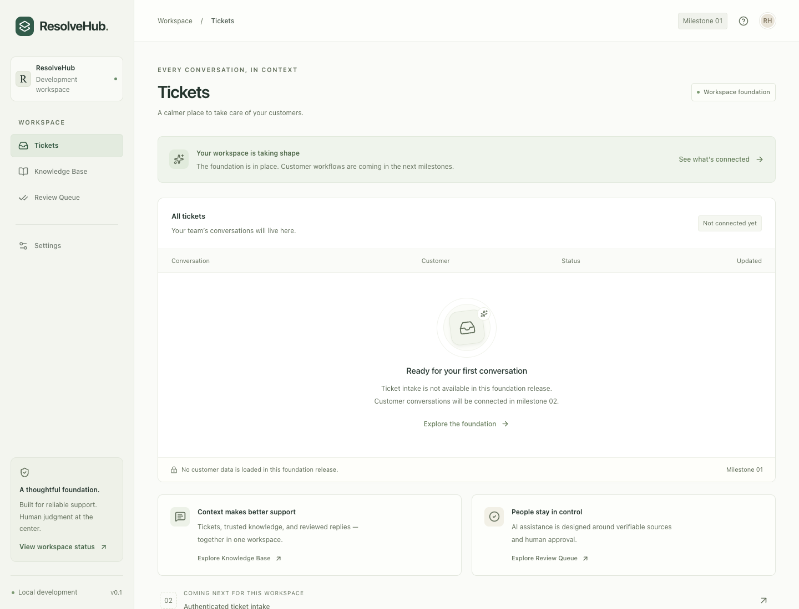

# ResolveHub

A multi-tenant AI customer support platform, built one verified milestone at a time. **Milestones 01 and 02 provide the local foundation and authenticated contract-first APIs.** The full roadmap is in [CODEX.md](CODEX.md); engineering rules are in [AGENTS.md](AGENTS.md).

The dashboard retains its foundation shell with working navigation and live health. The API supports tenant-authenticated REST commands and schema-first GraphQL reads, generated clients, durable idempotency, signed webhook receipts and audited review. No customer data is seeded automatically. Domain indexing/generation processors and outbound messaging remain deferred; accepted requests report their actual pending state.



## Start locally

Prerequisites: Node **22.22.3**, pnpm **12.10.1**, Docker with Compose v2 or later. Use `.nvmrc` with your Node version manager. Install pnpm with `npm install --global pnpm@12.10.1` if needed.

```sh
make setup         # creates an ignored .env if missing; frozen dependency install
make up            # PostgreSQL/pgvector, Redis and MinIO; waits for health checks
make migrate       # explicit, checksum-verified numbered SQL migrations
make dev           # Next.js, NestJS and the separate worker via Turborepo
```

Open **http://localhost:3000**. Settings → System health checks the real services. `make setup` generates a private API secret in ignored `.env`; example infrastructure values are for local use only. Provision expiring API credentials with `pnpm auth:bootstrap`; see the [API operations guide](docs/operations/contract-apis.md). Dashboard sign-in and data wiring remain future work. API callers use verified bearer credentials, never a trusted tenant header.

The first `make up` builds MinIO from a pinned official source commit because the public community images could not be pulled. It needs internet access and can take several minutes. See the [decision record](docs/architecture/decisions/0001-local-minio-source-build.md).

For compiled application startup:

```sh
pnpm build
pnpm start
```

Run only one application stack at a time. Stop it with Ctrl+C. `make down` stops infrastructure and preserves named volumes. Ports bind to loopback only. This development configuration is not a production deployment.

## Commands

| Command                          | Purpose                                                                                      |
| -------------------------------- | -------------------------------------------------------------------------------------------- |
| `pnpm install --frozen-lockfile` | Reproduce all eight workspace projects from the lockfile                                     |
| `pnpm dev`                       | Build shared dependencies, then watch all applications                                       |
| `pnpm check`                     | Format, lint, strict types, canonical contracts/controller validation, unit/contract tests   |
| `pnpm build`                     | Compile every package/service and production Next.js output                                  |
| `pnpm generate`                  | Regenerate the REST client and typed GraphQL documents                                       |
| `pnpm contracts:drift`           | Reject changed, deleted or untracked generated output                                        |
| `pnpm db:migrate`                | Apply outstanding checksum-verified SQL migrations                                           |
| `pnpm smoke`                     | Check web/API/worker readiness, process a real BullMQ probe and check duplicate job IDs      |
| `pnpm test:integration`          | Real authenticated HTTP contracts, tenant denial, idempotency, review, webhooks and pgvector |
| `pnpm test:e2e`                  | Browser navigation, responsive layout and health-error checks; requires installed Chrome     |
| `pnpm infra:check`               | Validate Compose without starting containers                                                 |
| `pnpm infra:down`                | Stop infrastructure without deleting data                                                    |

Smoke, integration and browser checks require `make up` and a running `pnpm dev` or `pnpm start` in another terminal. Unit checks need no external services. Changes to shared packages require restarting `pnpm dev` to rebuild their compiled exports.

## Workspace layout

```text
apps/web/              Next.js App Router, React, Tailwind
services/api/          NestJS REST commands and schema-first GraphQL reads
services/worker/       Standalone TypeScript BullMQ consumer and health server
packages/contracts/   OpenAPI 3.1, GraphQL SDL and executable operation documents
packages/generated/   Generated REST client and typed GraphQL documents
packages/db/          PostgreSQL/Drizzle lifecycle, migrations and scoped repositories
packages/ai/          Provider interface and deterministic abstaining mock
tests/                Jest unit/contract/integration and Playwright checks
infra/                Local PostgreSQL bootstrap and MinIO source Dockerfile
docs/                 Architecture, operations, verification evidence
.github/workflows/    Contract drift, validation, build and integration CI
```

The [architecture guide](docs/architecture/README.md) describes ownership and planned tenant boundaries. The [local operations guide](docs/operations/local-development.md) covers configuration, health semantics, outages and recovery. [Milestone verification](docs/verification/milestone-01.md) records actual checks and limits.

Milestone 03 is next: full Drizzle schema, runtime database roles/RLS, publication invariants and the fixture/migration corpus. Minimal durable handler storage is already present. Indexing/DLQ, grounded generation, releases and telemetry remain in later milestones. See [milestone 02 verification](docs/verification/milestone-02.md) and the [persistence/auth decision](docs/architecture/decisions/0003-contract-api-persistence-and-auth.md) for scope and limits.
