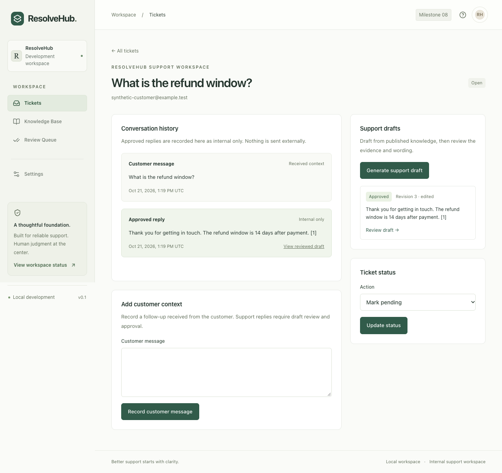

# ResolveHub

A multi-tenant AI customer support platform, built one verified milestone at a time. **Milestones 01–08 provide authenticated contract APIs, versioned persistence, durable ingestion, automated verification, evidence-bound support drafting, CI/CD and private operational telemetry.** The full roadmap is in [CODEX.md](CODEX.md); engineering rules are in [AGENTS.md](AGENTS.md).

Milestone 11 repairs the Gemini SDK server-deadline configuration and adds durable drafting-stage diagnostics, bounded retry recovery, and realistic offline SDK/worker fixtures. Generation remains `gemini-3.5-flash-lite`; embeddings and internal support records are preserved. **Offline verification and live acceptance are separate**: no Gemini requests ran for this repair, and citation-backed live drafting plus approval still require final acceptance after the rolling budget is available and Free Tier eligibility is reconfirmed. The daily application limit remains **10** with no paid fallback or automatic model switch. See [configuration/recovery](docs/operations/gemini-free-tier.md) and [verification evidence](docs/verification/milestone-11.md).

Google may use Free Tier inputs/outputs to improve its products; use synthetic records only. Keys remain backend-only. Free API estimates exclude infrastructure costs. Embeddings remain synthetic/64 because this project's `gemini-embedding-2` free quota is unconfirmed; no index is replaced or incompatible vector space mixed. Offline usage and all internal review/message workflows remain available.

The dashboard connects verified organization members to persisted tickets, knowledge uploads, cited drafts and human review. Approved replies become internal ticket messages in the same transaction as their review; they are never marked externally delivered. Browser sessions use HttpOnly cookies and server-side API calls. Document ingestion runs through MinIO, validated extraction/chunking, deterministic embeddings and atomic publication, with bounded BullMQ retries and a PostgreSQL dead-letter queue. Generation uses the explicitly labeled extractive mock by default, with an optional Ollama adapter. External customer delivery and webhook domain processing remain deferred.



## Start locally

Prerequisites: Node **22.22.3**, pnpm **12.10.1**, Docker with Compose v2 or later. Use `.nvmrc` with your Node version manager. Install pnpm with `npm install --global pnpm@12.10.1` if needed.

```sh
make setup         # creates an ignored .env if missing; frozen dependency install
make up            # PostgreSQL/pgvector, Redis and MinIO; waits for health checks
make dashboard     # migrate and provision the private local synthetic workspace
make dev           # Next.js, NestJS and the separate worker via Turborepo
```

Open **http://localhost:3000**. Settings → System health checks the real services. `make setup` generates a private API secret in ignored `.env`; example infrastructure values are for local use only. Provision expiring API credentials with `pnpm auth:bootstrap`; see the [API operations guide](docs/operations/contract-apis.md). Open `/sign-in` and choose **Open local workspace** after `make dashboard`. For other memberships, use an administrator-issued expiring access key. See [the complete internal workflow guide](docs/operations/internal-support.md). API callers use verified bearer credentials, never a trusted tenant header.

The first `make up` builds MinIO from a pinned official source commit because the public community images could not be pulled. It needs internet access and can take several minutes. See the [decision record](docs/architecture/decisions/0001-local-minio-source-build.md).

For compiled application startup:

```sh
pnpm build
pnpm start
```

Run only one application stack at a time. Stop it with Ctrl+C. `make down` stops infrastructure and preserves named volumes. Ports bind to loopback only. This development configuration is not a production deployment.

## Commands

| Command                                                    | Purpose                                                                                    |
| ---------------------------------------------------------- | ------------------------------------------------------------------------------------------ |
| `pnpm install --frozen-lockfile`                           | Reproduce all nine workspace projects from the lockfile                                    |
| `pnpm dev`                                                 | Build shared dependencies, then watch all applications                                     |
| `pnpm check`                                               | Format, lint, strict types, canonical contracts/controller validation, unit/contract tests |
| `pnpm build`                                               | Compile every package/service and production Next.js output                                |
| `pnpm generate`                                            | Regenerate the REST client and typed GraphQL documents                                     |
| `pnpm contracts:drift`                                     | Reject changed, deleted or untracked generated output                                      |
| `pnpm db:seed`                                             | Replace the two reserved synthetic organizations in a local database                       |
| `pnpm db:bootstrap --database resolvehub_synthetic --seed` | Create a new local database, migrate and seed it                                           |
| `pnpm db:migrate`                                          | Apply outstanding checksum-verified SQL migrations                                         |
| `pnpm dashboard:setup`                                     | Migrate and provision an expiring local development workspace membership                   |
| `pnpm smoke`                                               | Check web/API/worker readiness, process a real BullMQ probe and check duplicate job IDs    |
| `pnpm test` / `pnpm test:unit`                             | Jest unit and contract tests without Docker                                                |
| `pnpm typecheck`                                           | Strict workspace and test TypeScript checks                                                |
| `pnpm test:coverage` / `pnpm test:all`                     | Combined suite, isolated infrastructure and 80% branch gates per critical area             |
| `pnpm test:integration`                                    | Self-contained NestJS, PostgreSQL/Redis/MinIO Testcontainers and failure injection         |
| `pnpm test:e2e`                                            | Browser navigation, responsive layout and health-error checks; requires installed Chrome   |
| `pnpm test:dashboard`                                      | Build and verify authenticated desktop/mobile workflows with disposable infrastructure     |
| `pnpm infra:check`                                         | Validate Compose without starting containers                                               |
| `pnpm infra:down`                                          | Stop infrastructure without deleting data                                                  |

Smoke and browser checks require `make up` and a running `pnpm dev` or `pnpm start` in another terminal. Unit checks need no external services. Integration and coverage commands need Docker; they build the services, create disposable containers, run migrations and clean up automatically. They never load `.env`. The first run builds the pinned MinIO image if missing. See [automated verification](docs/operations/verification.md). Changes to shared packages require restarting `pnpm dev` to rebuild their compiled exports.

## Workspace layout

```text
apps/web/              Next.js App Router, React, Tailwind
services/api/          NestJS REST commands and schema-first GraphQL reads
services/worker/       Standalone TypeScript BullMQ consumer and health server
packages/contracts/   OpenAPI 3.1, GraphQL SDL and executable operation documents
packages/generated/   Generated REST client and typed GraphQL documents
packages/db/          PostgreSQL/Drizzle lifecycle, migrations and scoped repositories
packages/ai/          Embedding provider and deterministic abstaining draft mock
packages/telemetry/   Early SDK startup, private spans, bounded metrics and trace propagation
tests/                Jest unit/contract/integration, Playwright and k6 checks
infra/                Local dependencies, image/deployment configuration and observability
docs/                 Architecture, operations, verification evidence
.github/workflows/    Contract drift, validation, build and integration CI
```

The [architecture guide](docs/architecture/README.md) describes ownership and planned tenant boundaries. The [local operations guide](docs/operations/local-development.md) covers configuration, health semantics, outages and recovery. [Milestone verification](docs/verification/milestone-01.md) records actual checks and limits.

Milestone 03 adds the complete Drizzle models, tenant RLS/runtime grants, pgvector storage and exact scoped retrieval, atomic document publication/deletion, deterministic fixtures and upgrade/rollback tests. See [database operations](docs/operations/database.md), the [persistence decision](docs/architecture/decisions/0004-persistence-and-tenant-retrieval.md) and [milestone 03 verification](docs/verification/milestone-03.md). Milestone 04 adds the real document worker, checkpoints, four-attempt retry budget, global concurrency/provider limits, 1,000-run admission control and durable DLQ/replay. See [ingestion and recovery](docs/operations/ingestion-recovery.md), the [handoff decision](docs/architecture/decisions/0005-durable-ingestion-handoff.md) and [milestone 04 verification](docs/verification/milestone-04.md). The explicit 64-dimensional embedding model remains synthetic. Hybrid lexical retrieval complements its pgvector channel; production semantic embedding quality is not established by the synthetic provider.

Milestone 05 adds NestJS testing utilities, isolated PostgreSQL/Redis/MinIO Testcontainers, explicit provider status and transaction failure injection, and coverage gates. See the [verification decision](docs/architecture/decisions/0006-isolated-verification.md) and [milestone 05 evidence](docs/verification/milestone-05.md).

Milestone 06 adds tenant-filtered RAG, optional lexical reranking, bounded context, validated source quotations, rendered references, token/cost accounting, prompt versions, asynchronous draft processing and human approval gates. Run `pnpm ai:eval` (or `pnpm ai:benchmark`) for the fixed 60-case synthetic suite at ten concurrent database-backed requests. The combined integration suite also measures ten concurrent authenticated HTTP draft jobs. See [AI drafting operations](docs/operations/ai-drafting.md), [decision 0007](docs/architecture/decisions/0007-evidence-bound-drafting.md) and [milestone 06 results](docs/verification/milestone-06.md). Mock results do not establish live-model quality, latency or cost.

Milestone 07 adds read-only PR/merge-queue verification and protected-main/version-tag GHCR delivery, with separate non-root production images and digest-based promotion. Run `pnpm ci:workflows`, `pnpm security:scan`, `pnpm docker:build` and `pnpm docker:smoke`. See [release/deployment/rollback operations](docs/operations/releases.md), the [branch protection checklist](docs/operations/branch-protection.md), [decision 0008](docs/architecture/decisions/0008-ci-and-image-delivery.md) and [milestone 07 verification](docs/verification/milestone-07.md). Repository protection and registry permissions must be configured before enabling releases.

Milestone 08 adds early OpenTelemetry SDK initialization, private HTTP/GraphQL/SQL/Redis traces, durable request-to-worker context propagation, ingestion/RAG spans, token/cost and queue metrics, and provisioned Grafana/Tempo/Prometheus with tested alerts. Run `pnpm observability:up`, set `OTEL_ENABLED=true` in `.env`, then restart the apps. Grafana runs on http://127.0.0.1:3003; its private generated password is in ignored `.env.observability`. `pnpm observability:check` validates configuration and alert firing; `pnpm observability:verify` checks the running services and authenticated provisioning. `pnpm perf:run` measures isolated k6 drafting and queue saturation with mock providers. See [operations/recovery](docs/operations/observability.md), [performance measurements and limits](docs/performance-report.md), [decision 0009](docs/architecture/decisions/0009-private-operational-telemetry.md) and [milestone 08 verification](docs/verification/milestone-08.md).

The authenticated dashboard follow-up connects ticket creation/status/context/history, private knowledge uploads and revisions, cited draft generation, editing, approval/rejection and audited internal replies. Run `pnpm dashboard:setup` for a local development-only account and `pnpm test:dashboard` for isolated desktop/mobile workflow verification. See [workflow operations](docs/operations/internal-support.md), [decision 0010](docs/architecture/decisions/0010-authenticated-dashboard-and-internal-replies.md) and [verification](docs/verification/internal-support-workflow.md).
