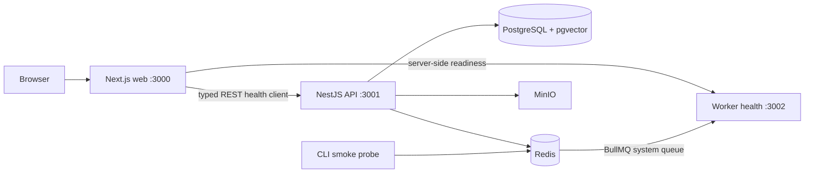

# Architecture and ownership

Milestone 01 establishes process/package boundaries without customer-facing domain endpoints. Next.js 16, NestJS 12 and a standalone BullMQ process run on Node 22; pnpm and Turborepo own dependency and task ordering. Tailwind 4 uses its PostCSS integration. Exact resolved versions are locked in `pnpm-lock.yaml`.

Browser code receives only safe status results. Database, Redis and storage addresses stay in server environment variables. The web status route uses finite timeouts and the generated client; the API performs real dependency checks. The worker has its own readiness server and processes only validated operational probes. No domain payload can enter the system through the probe processor.

| Workspace   | Current responsibility                             | Dependency boundary           |
| ----------- | -------------------------------------------------- | ----------------------------- |
| `web`       | Routes, shell, live health UI                      | contracts, generated client   |
| `api`       | HTTP validation, safe errors, dependency readiness | contracts, db                 |
| `worker`    | Operational BullMQ consumer, readiness, shutdown   | contracts                     |
| `contracts` | Runtime health/job schemas, OpenAPI source         | no services                   |
| `generated` | Generated OpenAPI types and client factory         | contracts; no domain logic    |
| `db`        | Drizzle client and bounded PostgreSQL pool         | no services/web/AI            |
| `ai`        | Typed draft provider and abstaining mock           | no database or network access |

OpenAPI is the source of REST client types. Zod validates actual network/job input at runtime. The domain contract milestone must add drift/compatibility checks for each domain operation and introduce the canonical GraphQL SDL. The intended schema-first GraphQL adapter is Nest's Apollo adapter on the existing Express transport; resolvers will delegate to the same application services as REST.

No tenant data or domain routes exist yet. Before introducing one, implement verified sessions/tokens and organization membership, tenant-scoped application context and repositories, composite keys, isolation tests, and non-disclosing authorization errors. Never derive authority from `organizationId` supplied by clients or queues. The local PostgreSQL bootstrap role is intentionally a development owner; domain migrations must introduce a separate least-privilege runtime role before customer data is stored.

Domain idempotency, durable application DLQ, transactional index publication, migrations/seeds and retrieval are future work, not properties demonstrated by the system probe. Redis job-ID deduplication is verified only for operational probes; it is not exactly-once delivery or durable domain idempotency.

Configuration is validated independently at each process's startup. The mock AI adapter always abstains and has no external credentials; it is not evidence-grounded generation. Observability collectors, release images and hosting are intentionally reserved for later milestones. No Sites hosting is used for this local Node/TCP-based architecture.
