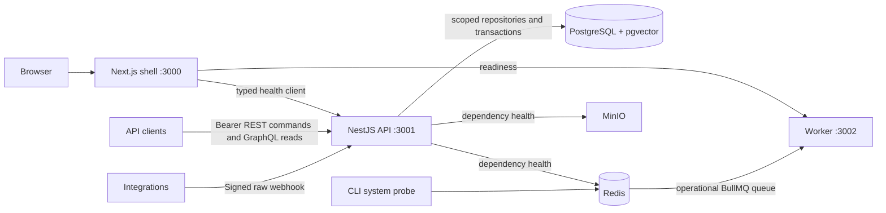

# Architecture and ownership

Milestone 01 established process boundaries; milestone 02 adds authenticated contract APIs, and milestone 03 expands Drizzle persistence, version publication and tenant database policies. Next.js 16, NestJS 12 and a separate BullMQ process run on Node 22. pnpm/Turborepo orchestrate shared builds and independent processes. Exact resolved versions are locked in `pnpm-lock.yaml`.

The dashboard continues to expose navigation and safe health results. Customer API credentials are not stored in browser code. Controllers/resolvers delegate to application services; every repository operation uses verified server-derived organization context. Domain requests are persisted as accepted handoffs in PostgreSQL; they are not processed by the operational probe worker.

| Workspace   | Responsibility                                                                 | Boundary                                              |
| ----------- | ------------------------------------------------------------------------------ | ----------------------------------------------------- |
| `web`       | Shell, navigation and live health                                              | contracts and generated client; no direct data access |
| `api`       | Membership, REST/GraphQL, policy, review, webhook verification                 | contracts, generated types, scoped db repositories    |
| `worker`    | System probes, readiness, shutdown                                             | contracts; no domain processors yet                   |
| `contracts` | OpenAPI 3.1, schema-first SDL, operations and health schemas                   | no services/database                                  |
| `generated` | openapi-fetch client and client-preset typed documents                         | no business logic                                     |
| `db`        | Drizzle/pg lifecycle, migrations, scoped Drizzle/SQL, publication and receipts | no services/web/AI                                    |
| `ai`        | Provider interface and abstaining mock                                         | no database/network calls                             |

REST requests use canonical OpenAPI JSON Schemas through AJV 2020. Nest's Apollo/Express adapter loads the canonical SDL directly. Both transports share application services, authentication and database policy. Zod validates environmental/operational boundaries and narrow internal inputs. Generation and route/operation checks fail CI on drift; real HTTP tests validate responses against OpenAPI and exercise generated operations.

Opaque expiring credentials are stored only as hashes and joined to active membership on every request. Webhook identity is derived from a server-side integration after raw-byte HMAC verification. No client tenant field grants authority. Page cursors are encrypted/authenticated and bound to organization, operation, filters and a timestamp cutoff. Read ordering is immutable timestamp plus UUID.

Tenant-scoped idempotency records, payload fingerprints, original receipts, domain changes and audit events commit together. Reviews lock state, check revisions/current published evidence, and record a human actor. Approval does not deliver messages. GraphQL knowledge search remains literal matching over authorized active versions. The database repository now supports exact pgvector ranking over tenant-filtered current versions. Its vectors and seeded drafts are synthetic; semantic retrieval quality and grounded generation remain future work.

The [contract persistence/auth decision](decisions/0003-contract-api-persistence-and-auth.md) explains the minimal schema needed for working handlers. The [persistence decision](decisions/0004-persistence-and-tenant-retrieval.md) describes Drizzle models, RLS, runtime grants, publication and fixtures. The Compose owner role is for local administration; API deployments must use the separate non-owner role described in [database operations](../operations/database.md).

Domain BullMQ execution/durable DLQ, grounded AI/evaluations, releases and telemetry retain their original milestones. System probe deduplication is not exactly-once delivery. Configuration fails closed at startup, errors avoid stack/secret leaks, and provider behavior is never replaced with fabricated success.
