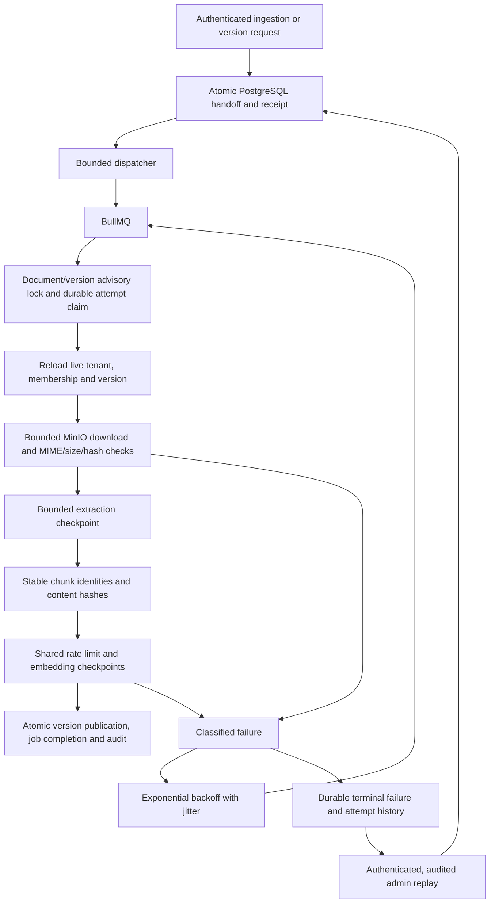

# 0005 — Durable ingestion handoff and version checkpoints

Date: 2026-10-21. Status: accepted for milestone 04.

The API commits document/version identity, a `job_runs` handoff, the requester, audit and idempotency receipt in PostgreSQL before returning 202. The worker dispatches due handoffs to BullMQ every 500 ms using stable tenant/job queue identifiers. The dispatcher acknowledges delivery separately; repeated handoff is safe. This avoids losing an accepted request between a database commit and Redis delivery. Redis failure delays processing; accepted work remains visible in PostgreSQL.

A PostgreSQL session advisory lock scopes work to organization/document/version and lasts through the attempt without holding a SQL transaction across external I/O. A connection failure releases that lock; the failed connection cannot publish later. Every stage uses the same checked-out connection and server tenant context, then resets it before pool return. Completed extraction is keyed by immutable version identity/fingerprint and pipeline version. Chunks have deterministic version/ordinal/content IDs. Embedding updates commit in bounded batches and skip existing vectors. A final transaction rechecks authority and version order, publishes the pointer, supersedes the prior version, completes the job/attempt and inserts its audit. Staged or failed replacement data is never retrieved through the prior active pointer.

PostgreSQL is authoritative for the **four-attempt budget**. A claimed attempt that stops before completion is recorded as abandoned on recovery. A fresh Redis delivery cannot reset this budget. BullMQ also uses four attempts, exponential backoff with 50–100% jitter and finite retention. A custom strategy carries the persisted retry delay and supports a provider's Retry-After. If Redis loses a delayed job or marks an infrastructure-only delivery failed, the dispatcher reconstructs it from durable due state. Database failure before a claim does not consume a processing attempt. Durable terminal state is written before throwing BullMQ's `UnrecoverableError`; it does not depend on a Redis failed-event listener.

Admission uses a transaction advisory lock and a trusted aggregate function to cap **unfinished document runs at 1,000**. Accepted handoffs, delayed retries and processing runs retain their slot. This is deliberately conservative against a waiting-only limit: active work also occupies capacity, and the cap remains meaningful when Redis is offline. Existing idempotency receipts replay before admission checks. Manual replay reserves capacity too. Excess requests receive correlated 429 errors and `Retry-After: 30`.

Consumer concurrency is bounded from 1–16, defaults to 2, and is also applied as BullMQ global concurrency. A Redis Lua window limits actual embedding batch calls across worker processes using the same deployment prefix and model, default 10 requests/second. Batches contain at most 16 chunks. The worker pool has concurrency + 2 connections for processing, dispatch and readiness. Provider calls default to 5 seconds; downloads/extraction to 10 seconds; attempt cancellation defaults to 60 seconds. PostgreSQL statements have a 2-second timeout; checkpoints and cancellation keep each phase finite. A 150-second processing lease permits re-delivery after interruption; the advisory lock still prevents concurrent execution if a slow live attempt holds it.

PDF.js 6.4.299 runs in a separate worker thread with a 128 MiB old-generation limit, at most 200 pages, 200,000 extracted characters and a 10-second extraction deadline. UTF-8 plain text and Markdown use fatal decoding and reject binary signatures/NULs. All types enforce actual streamed bytes, stored size, MIME and SHA-256; chunks are at most 1,000 characters with 100-character overlap, capped at 256. S3 SDK retries are disabled so the job owns retry policy. No arbitrary URL fetch or embedded document instruction is executed.

The implemented embedding adapter remains **resolvehub-synthetic-sha256-v1, 64 dimensions**, matching migration 0003 and fixtures. Its vectors are deterministic numeric test data. This milestone verifies ingestion mechanics and isolation, not semantic quality. Real provider adapters and evidence-grounded drafting remain milestone 06.

`failed_jobs` retains category, safe summary, input fingerprint, request correlation, replay eligibility and lineage; `job_attempts` retains the stage and outcome of each attempt. A permanent file/authorization/state failure uses one attempt and cannot be replayed as the same immutable version. Transient exhaustion can be replayed by a current tenant administrator into a new run, with one replay child per failed run. Original failure history remains intact. Legacy failed fixtures from before worker execution have no invented attempt history or replay eligibility.

Runtime roles remain non-owner and `NOBYPASSRLS`. The API may call only the global admission count; the worker's separate role may call a trusted, bounded dispatch function returning tenant/job identifiers. Both functions capture the migration schema in a fixed search path and revoke PUBLIC execution. Domain reads/writes use tenant policies. Tests exercise both grant scripts and denied API access to worker dispatch.

References: [BullMQ retries](https://docs.bullmq.io/guide/retrying-failing-jobs), [production connection behavior](https://docs.bullmq.io/guide/going-to-production), [global concurrency](https://docs.bullmq.io/guide/queues/global-concurrency), [AWS SDK S3 streaming](https://docs.aws.amazon.com/sdk-for-javascript/v3/developer-guide/creating-and-calling-service-objects.html), [PDF.js API](https://mozilla.github.io/pdf.js/api/draft/module-pdfjsLib.html).
