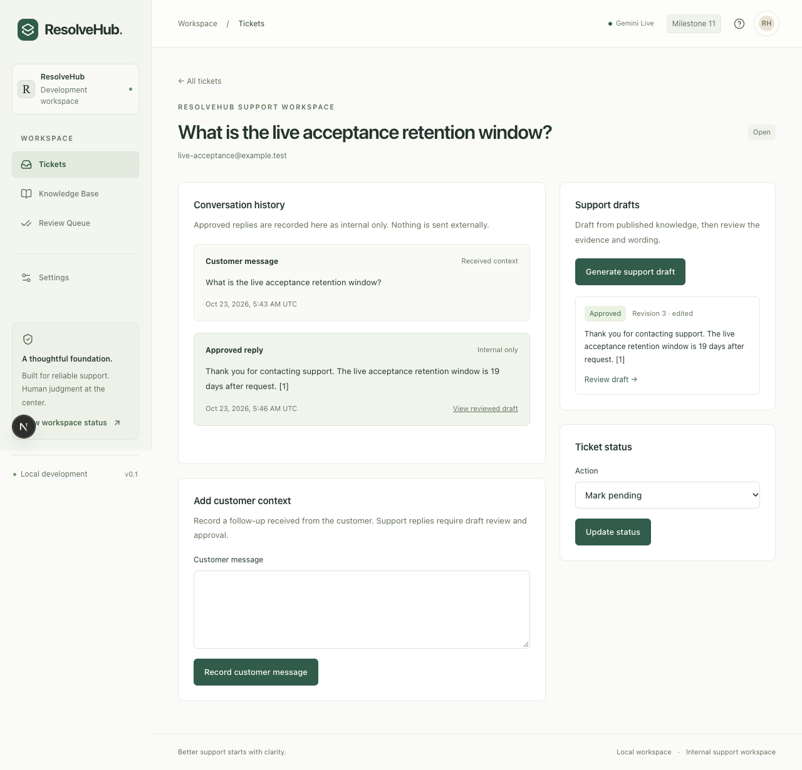

# ResolveHub live Gemini acceptance — October 23, 2026

**Live acceptance passed for the synthetic internal support workflow. Exactly one genuine Gemini generation request was used; the second authorized request was not used.** Baseline `26f0a47` (milestone 11), macOS/arm64, Node 22.22.3, pnpm 12.10.1. The API, worker, dashboard and persistent local PostgreSQL/pgvector, Redis and MinIO were used. No mock generation, paid model/feature, fallback, Gemini embedding call, billing change, image push or remote deployment occurred.

## Gates before the call

The local preflight at **2026-10-23 05:36:13 UTC / 1:36:13 PM Manila** established:

- The prior model-failure cooldown had naturally expired. Its Redis key and project quota-block key were absent; neither was deleted to open admission.
- All prior rolling-day requests had naturally aged out. Counts were **0/day and 0/minute** against unchanged ceilings of **10/day, 2/minute, concurrency 1**. No ledger reset or prefix change occurred.
- The user's Google AI Studio confirmation from October 22 remained within the existing 24-hour key/project/model-bound verification window. It confirms project `gen-lang-client-0088737565`, Free Tier active, billing disabled/unlinked and free quota for `gemini-3.5-flash-lite`. This was an operator assertion, **not an independent billing API audit**. The unchanged assertion expires October 23 at **6:50 PM Manila**. A working key alone was not used as billing proof.
- The configured key still matched its verified digest and exact approved model. `geminiEligibility` passed; authenticated application status allowed generation. Successful model access was subsequently confirmed by the one actual generation response, not an extra discovery call.
- There were **zero pending drafting jobs** before the worker started. `GEMINI_MAX_ATTEMPTS=1` and SDK `attempts: 1` prevented retry amplification. A test-only transport monitor additionally capped this acceptance session at two requests and could block all further calls.

Docker Desktop initially needed starting. Existing persistent containers and volumes were reused. The expired reserved synthetic dashboard credential was renewed through the existing local setup utility; records/indexes were not reseeded, reset or rebuilt. The model and synthetic/64 embedding profile were preserved. The development stack then became ready.

## Actual provider and pipeline measurements

| Observation                                 | Measured result                                                                                                              |
| ------------------------------------------- | ---------------------------------------------------------------------------------------------------------------------------- |
| Request start                               | 2026-10-23 05:43:31.229 UTC / 1:43:31.229 PM Manila                                                                          |
| Endpoint                                    | Official Developer API `v1beta`, exact `gemini-3.5-flash-lite:generateContent` route, official `@google/genai` 2.30.0 SDK    |
| Response                                    | **HTTP 200**, returned model `gemini-3.5-flash-lite`, finish reason **STOP**                                                 |
| Calls / worker attempts                     | **1 / 1**, with no retry or fallback; Redis rolling count increased **0 → 1**                                                |
| Provider-reported input / output            | **209 / 111 tokens**, total **320**; no fabricated token estimates                                                           |
| HTTP headers / full metadata capture        | **1,152.88 / 1,154.63 ms**                                                                                                   |
| Retrieval                                   | **11.91 ms**, tenant-filtered PostgreSQL hybrid retrieval                                                                    |
| Generation stage                            | **1,163.26 ms**                                                                                                              |
| Whole RAG pipeline                          | **1,177.46 ms**                                                                                                              |
| Queue + dashboard polling until review link | **2,363.02 ms**                                                                                                              |
| Estimated variable API cost                 | **$0 under the operator-verified Free Tier pricing assumption**; no invoice/billing audit or infrastructure cost measurement |

No live p50/p95/concurrency SLA, broad semantic accuracy or abstention benchmark is inferred from a single case. The model performed evidence-bound quotation selection; this is not a generic chatbot or proof of arbitrary prose entailment. Hash embeddings remain non-semantic; hybrid retrieval supplies the current search behavior.

## Verified real workflow

The browser uploaded a new, clearly synthetic document through the real MinIO ingestion workflow, created a synthetic customer ticket, and requested one live draft through the authenticated dashboard. The source was deliberately unique so an older document with a similar subject could not satisfy the expected evidence identifier.

> The live acceptance retention window is 19 days after request.

The pipeline generated exactly that supported quotation with reference `[1]`. The following immutable identifiers were independently verified through authenticated GraphQL and scoped read-only database queries:

| Resource            | Identifier                             |
| ------------------- | -------------------------------------- |
| Ticket              | `2e2c83ac-6366-4485-9cf9-584f97420206` |
| Draft / source job  | `b9fbcf91-7975-493b-85ee-dd75cf98f105` |
| Request correlation | `457c0f2a-0aad-431b-95e9-361516ae8c48` |
| Document            | `d06c058d-ed38-47b0-99f3-48ad95337507` |
| Published version   | `62dba076-eecb-4d86-a312-42804a95ad53` |
| Chunk               | `9410a577-be0b-4528-a01f-f4d231ca2d4f` |

Citation checks joined the same organization, active document pointer, indexed/nondeleted version and nondeleted chunk, then verified the exact quote occurs in the source. Exactly **one** eligible citation remained. The database had the provider/model metadata, reported usage, `evidence_validated=true`, a succeeded one-attempt job and attempt stage `complete`.

Human-review actions were then verified through the real dashboard:

1. Opened the saved live draft from the ticket conversation, with its source quote and reference visible.
2. Edited the wording to “Thank you for contacting support. The live acceptance retention window is 19 days after request. [1]” and saved revision **2**.
3. Explicitly checked the human acknowledgement and approved; the draft became `approved`, revision **3**, with reviewer and review timestamp recorded.
4. Observed exactly **one** edited reply in ticket history labeled **Internal only**. Authenticated GraphQL and database checks confirmed `author=agent`, `delivery_status=internal`, the correct source draft and exact edited body. **Zero** externally delivered messages were recorded.
5. Verified one audit entry each for request, generation, edit and approval, and the dashboard's **Gemini Live** indicator.

## Verification interruptions and minimal repair

The first browser attempt hit a development reload loop **before any Gemini request**. Moving only the generated Next.js cache aside and restarting resolved it; sign-in succeeded. Persistent data, model settings and provider limits were unchanged.

The actual generation request then succeeded and its cited draft persisted, but the smoke harness read `page.url()` immediately after clicking a Next.js review link. The saved-draft continuation reproduced that timing: immediately after the click, the path was still the ticket URL; waiting for the review URL completed navigation successfully. The existing harness could therefore query the wrong draft ID and falsely fail. The single-line fix adds an explicit review-URL assertion before extracting the ID. It changes verification synchronization only, not product architecture, citation rules or authorization.

After this interruption, all additional cloud calls were blocked. The already-persisted genuine live draft was opened, edited and approved without regeneration. **The initial smoke command did not pass uninterrupted; the actual complete workflow passed by continuing that same saved live draft.** No second provider request was used to retry or guess at an error.

A temporary generated-cache backup initially caused duplicate-package resolution failures in two coverage suites. The backup was moved outside Jest's scan, and the full suite was rerun. This was verification-environment cleanup, not a domain/AI implementation change. A subsequent clean run exposed a pre-existing Redis limiter cancellation race: a caller aborted during the awaited Redis grant could still return as admitted. A one-line post-response abort check fixes that race, with a deterministic regression that aborts while the grant is returned. The full suite was rerun after this separate reliability fix. The final portfolio security scan also caught [GHSA-c4qx-w738-7hr3](https://github.com/advisories/GHSA-c4qx-w738-7hr3) in the API's `@graphql-tools/utils` 12.0.1 dependency. The narrow pnpm override selects the upstream patched 12.0.2 release; the lockfile, generated contracts, tests and production images were reverified. No exception was added for this runtime advisory. The existing development-only `braces` exception still expires November 21. No failure was omitted to claim acceptance; no extra cloud request was used.

## Regression and deployment preparation

Final command results are recorded with the sanitized [measurement artifact](live-acceptance-2026-10-23-metrics.json). Normal regression suites use isolated infrastructure and mocked cloud responses, separately from the single live request above.

| Command                                              | Final measured result                                                                                                                                                 |
| ---------------------------------------------------- | --------------------------------------------------------------------------------------------------------------------------------------------------------------------- |
| `pnpm install --frozen-lockfile`                     | All 9 workspaces passed against the security-patched lockfile.                                                                                                        |
| `pnpm check`                                         | Formatting, lint, strict workspace/test TypeScript, OpenAPI/GraphQL validation and **240 unit/contract tests / 24 suites** passed.                                    |
| `pnpm test:coverage`                                 | **360 tests / 36 suites passed**, **92.33% branch coverage**, all independent 80% critical-area gates passed. Includes the new deterministic cancellation regression. |
| `pnpm test:dashboard`                                | Final production build and **16 desktop/mobile checks passed** after the GraphQL dependency patch.                                                                    |
| `pnpm contracts:drift`                               | REST/GraphQL generated clients unchanged and aligned with their contracts after the dependency patch.                                                                 |
| `pnpm security:scan`                                 | No blocked advisories after the runtime patch. One existing development-only exception remains, expiring November 21.                                                 |
| `pnpm docker:build` / `pnpm docker:smoke`            | Final web/API/worker arm64 images built and non-root/read-only/secrets/health/migrations/REST/GraphQL/queue/shutdown smoke checks passed locally. No push.            |
| Production Compose + Gemini overlay `config --quiet` | Example configuration syntax passed; this does not validate actual target credentials, release digests, DNS/TLS or deployed connectivity.                             |

Fixes were committed separately: `bc7696f` (wait for review navigation), `f83150a` (post-Redis cancellation check and deterministic regression), `0ef6268` (runtime GraphQL utility security patch). No customer-facing feature, model, embedding space, tenant policy or delivery integration was changed.

Live acceptance is complete for the demonstrated synthetic internal workflow. Existing production image/configuration examples and [portfolio deployment notes](../operations/portfolio-deployment.md) are prepared for staging. Hosting target, domain/TLS, real release digests, least-privilege secrets, backups and deployed readiness checks remain required before a public rollout. No paid service was selected or enabled. Free API access does not imply free infrastructure. Real customer data is not authorized for this provider; Google may use Free Tier inputs/outputs to improve its products.
